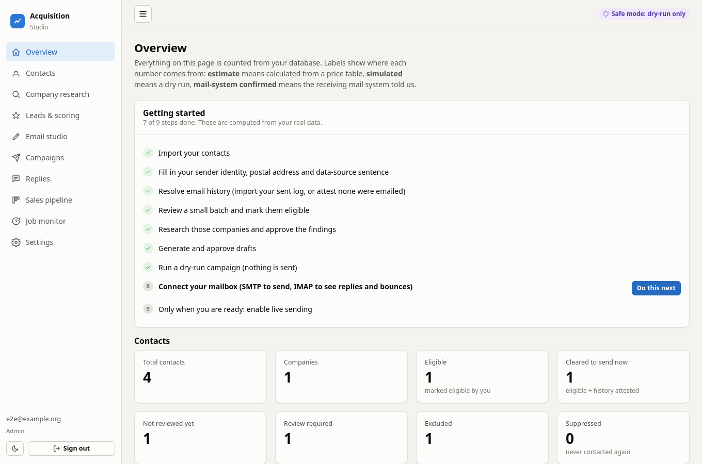
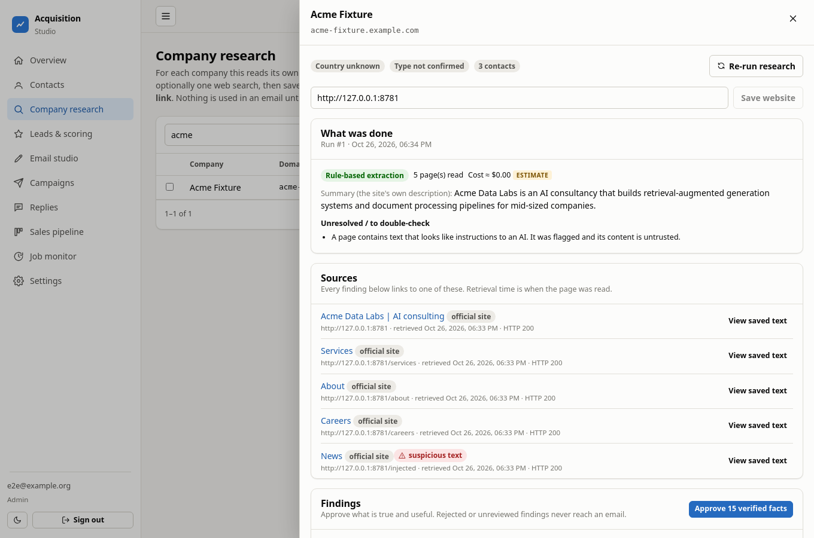
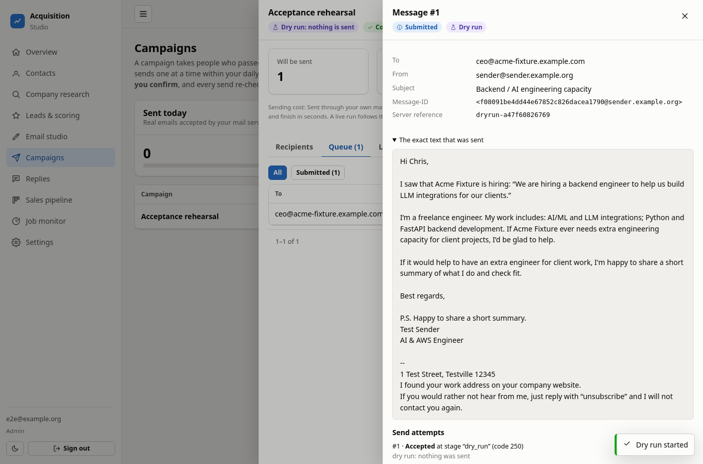

# Client Acquisition Studio

A private workspace for finding, researching and carefully contacting B2B prospects as a freelance AI / Python / AWS engineer.
You review everything. Nothing is emailed until you deliberately turn real sending on.



## How it works

```
import contacts → review & compliance gates → research the company (with sources)
   → score the lead → draft from approved facts → you approve the exact text
   → dry-run campaign first → careful sending → replies, bounces, opt-outs → pipeline
```

| Research with sources | Draft built from approved facts |
|---|---|
|  |  |



*Screenshots use synthetic test data. The campaign above is a dry run: nothing was sent.*

## What it does

- **Contacts:** import `.xlsx` / `.csv` with preview and column mapping; duplicates and bad addresses are handled.
- **Research:** reads each company's own website; every finding has an exact quote and source link, and you approve it.
- **Email studio:** drafts use only approved facts and your own profile. Approval is tied to the exact text.
- **Campaigns:** typed confirmation, daily and hourly caps, sending windows, pause and cancel.
- **Replies:** reads your inbox (read-only), sorts replies, handles bounces, and honours opt-outs immediately.
- **Pipeline and jobs:** leads, tasks and deals; background jobs that survive restarts.

## Safe by design

- Nobody gets the same email twice. This is enforced inside PostgreSQL, not just in code.
- Anyone who opts out or bounces can never be emailed again.
- Real sending needs three separate switches plus a typed confirmation per campaign.
- Secrets live in `.env` only. The UI shows whether they are set, never the values.

## Start it

Needs Docker.

```bash
./scripts/setup.sh                 # creates .env with generated passwords
docker compose up -d --build
```

Open http://localhost:8000 and sign in with the password the script printed.
First-day walkthrough: [docs/04-setup-and-operations.md](docs/04-setup-and-operations.md).

## Good to know

- Real providers (SMTP, IMAP, AI, search) have not been tested live. Start with a handful of emails.
- "Sent" means your mail server accepted the message, not that it was delivered.
- Cold email is restricted in many countries. The built-in country rules are a starting point, not legal advice.
- Contact files hold personal data. `data/`, `backups/` and `.env` are git-ignored; never commit them.

## Docs

[Audit and research](docs/01-audit-and-research-report.md) ·
[Architecture](docs/02-architecture-decision-record.md) ·
[Setup and operations](docs/04-setup-and-operations.md) ·
[Backup](docs/05-backup-and-recovery.md) ·
[Deployment](docs/06-deployment-guide.md) ·
[Costs](docs/07-cost-estimate.md) ·
[Security](docs/09-security-review.md)

## Development

```bash
docker compose up -d db
cd backend && python3 -m venv .venv && . .venv/bin/activate && pip install -r requirements-dev.txt
alembic upgrade head && python -m pytest
cd ../frontend && npm ci && npm test && npx playwright test
```
