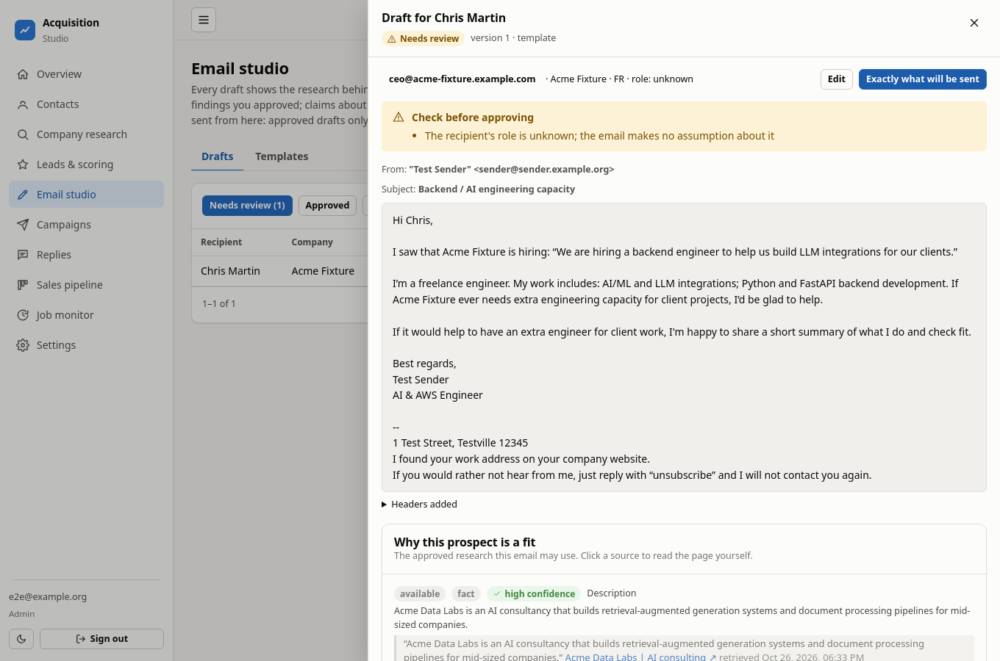

# Client Acquisition Studio

A private workspace for finding, researching and carefully contacting B2B prospects as a freelance AI / Python / AWS engineer.
You review everything. Nothing is emailed until you deliberately turn real sending on.


## AI that searches and analyses

- **Search:** finds a company's official pages and recent signals, such as a hiring post, through web search.
- **Analysis:** an AI model reads those pages and pulls out facts, each with an exact quote that the app verifies against the page.
- **Drafting:** the AI can write an email, but only from facts you approved, and every claim points back to its source.

AI is optional. Without API keys the app falls back to free fixed rules. The AI never sends anything: you approve every fact and every email.

## How it works

```
import contacts → review & compliance gates → AI-assisted company research (with sources)
   → score the lead → draft from approved facts → you approve the exact text
   → dry-run campaign first → careful sending → replies, bounces, opt-outs → pipeline
```

| Research with sources | Draft built from approved facts |
|---|---|
|  |  |


*Screenshots use synthetic test data. The campaign above is a dry run: nothing was sent.*

## What it does

- **Contacts:** import `.xlsx` / `.csv` with preview and column mapping; duplicates and bad addresses are handled.
- **Research:** every finding has an exact quote and source link, and you approve it.
- **Email studio:** approval is tied to the exact text; changing a word cancels it.
- **Campaigns:** typed confirmation, daily and hourly caps, sending windows, pause and cancel.
- **Replies:** reads your inbox (read-only), sorts replies, handles bounces, and honours opt-outs immediately.
- **Pipeline and jobs:** leads, tasks and deals; background jobs that survive restarts.

## Safe by design

- Nobody gets the same email twice. This is enforced inside PostgreSQL, not just in code.
- Anyone who opts out or bounces can never be emailed again.
- Real sending needs three separate switches plus a typed confirmation per campaign.
- Secrets live in `.env` only. The UI shows whether they are set, never the values.

## Start it

Needs Docker.

```bash
./scripts/setup.sh                 # creates .env with generated passwords
docker compose up -d --build
```

Open http://localhost:8000 and sign in with the password the script printed.

**First day, dry run only**

1. Settings → fill in your sender identity, postal address and where you found their addresses.
2. Contacts → Import…, choose your file, check the column mapping.
3. Pick about 10 contacts, set their country, mark them eligible, and attest that country's rule in Settings.
4. Company research → run it, then approve the facts that are true.
5. Email studio → generate and approve a draft. Campaigns → run a dry-run campaign.

To send for real, add your mailbox (`SMTP_*`, `IMAP_*`) and any AI keys to `.env`, then flip the three switches: `LIVE_SENDING_ENABLED=true`, live mode in Settings, and provider SMTP.

## Good to know

- Real providers (SMTP, IMAP, AI, search) have not been tested live. Start with a handful of emails.
- "Sent" means your mail server accepted the message, not that it was delivered.
- Cold email is restricted in many countries. The built-in country rules are a starting point, not legal advice.
- Contact files hold personal data. `data/`, `backups/` and `.env` are git-ignored; never commit them.

## Development

```bash
docker compose up -d db
cd backend && python3 -m venv .venv && . .venv/bin/activate && pip install -r requirements-dev.txt
alembic upgrade head && python -m pytest
cd ../frontend && npm ci && npm test && npx playwright test
```
